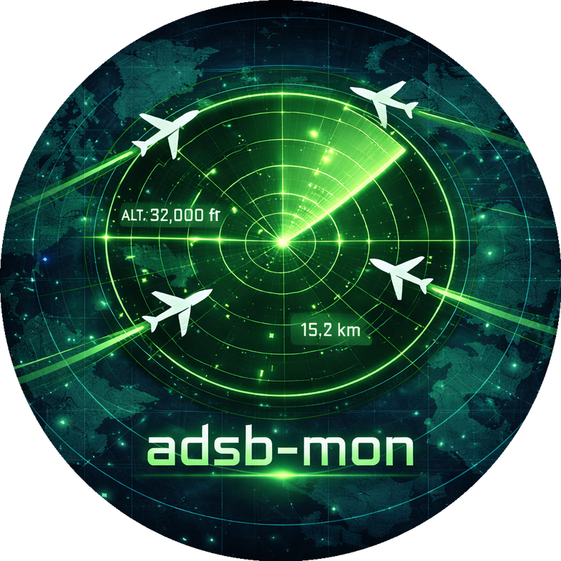

# adsb-mon — RTL-SDR Real-Time Aircraft Tracker

A Python-based application for real-time aircraft tracking using Software-Defined Radio (SDR). This tool receives, decodes, and visualizes ADS-B (Automatic Dependent Surveillance-Broadcast) signals transmitted by aircraft, displaying live flight information on an interactive map with enriched data from online sources.


[](https://sonarcloud.io/summary/new_code?id=infosecm_adsb-mon)


## Features

### Core Functionality
- **Real-Time ADS-B Decoding**: Tunes RTL-SDR dongle to 1090 MHz and decodes Mode-S/ADS-B messages in real-time
- **Live Aircraft Table**: Displays comprehensive flight data including:
  - ICAO 24-bit address (unique aircraft identifier)
  - Callsign/flight number
  - Altitude (feet)
  - GPS coordinates (latitude/longitude)
  - Ground speed (knots)
  - Heading (degrees)
  - Vertical rate (climb/descent rate)
  - Squawk code (transponder code)
  - Message count and last-seen timestamp
  
- **Interactive Map Visualization**:
  - OpenStreetMap integration with live positioning
  - Rotating aircraft icons that align with actual heading
  - Flight path trails (approximately 3 minutes of history)
  - Clickable markers to select aircraft
  - Hover tooltips showing detailed flight information

- **Detailed Aircraft Information Panel**:
  - Aircraft registration number
  - Aircraft type and manufacturer
  - Operator/airline information
  - Flight route (origin → destination)
  - High-resolution aircraft photos from planespotters.net

- **Online Data Enrichment**:
  - Background API calls to hexdb.io for aircraft metadata
  - Automatic photo retrieval from planespotters.net
  - No API keys required — all services are free

- **Demo Mode**: If no SDR hardware is detected, the application runs with 5 simulated aircraft for testing and demonstration purposes

### User Interface
- Modern dark-themed GUI with color-coded information
- Intuitive controls: ▶ Start / ⏹ Stop / 🗑 Clear
- Activity log showing status messages and aircraft state changes
- Responsive layout with synchronized table and map selection

---

## Installation

### Prerequisites

**Hardware:**
- RTL-SDR dongle (RTL2832U + R820T/R820T2 tuner)
- Antenna suitable for 1090 MHz reception (ideally a dedicated ADS-B antenna)

**Software:**
- Python 3.10 or higher

### Platform-Specific Setup

#### Windows

##### 1. Install Python
Download and install Python 3.10+ from [python.org](https://www.python.org/downloads/)

##### 2. Install RTL-SDR Drivers (Critical Step)

**Using Zadig (Recommended):**

1. Download Zadig from [zadig.akeo.ie](https://zadig.akeo.ie/)
2. Plug in your RTL-SDR dongle
3. Launch Zadig
4. Go to **Options → List All Devices**
5. Select **Bulk-In, Interface (Interface 0)** from the dropdown
   - You may see it as "RTL2838UHIDIR" or similar
6. In the target driver box (right side with green arrow), select **WinUSB**
7. Click **Replace Driver** or **Install Driver**
8. Wait for completion (may take 1-2 minutes)
9. Restart your computer

**Required DLL Files:**

The pyrtlsdr library requires three DLL files. Place them in the same directory as the script or ensure they're in your system PATH:

- `librtlsdr.dll`
- `libusb-1.0.dll`
- `libwinpthread-1.dll`

You can download pre-compiled Windows binaries from:
- [rtl-sdr.com releases](https://ftp.osmocom.org/binaries/windows/rtl-sdr/)
- Or compile from source: [osmocom/rtl-sdr](https://github.com/osmocom/rtl-sdr)

**To add DLLs to PATH temporarily:**
```cmd
set PATH=%CD%;%PATH%
```

##### 3. Install Python Dependencies
```cmd
pip install pyrtlsdr==0.2.91 numpy tkintermapview pillow
```

##### 4. Run the Application
```cmd
python adsb_decoder.py
```

---

#### Linux (Ubuntu/Debian)

##### 1. Install System Dependencies
```bash
sudo apt update
sudo apt install python3 python3-pip rtl-sdr librtlsdr-dev libusb-1.0-0-dev
```

##### 2. Configure USB Permissions

Create a udev rule to allow non-root access to the RTL-SDR device:

```bash
sudo nano /etc/udev/rules.d/20-rtlsdr.rules
```

Add the following line:
```
SUBSYSTEM=="usb", ATTRS{idVendor}=="0bda", ATTRS{idProduct}=="2838", MODE="0666"
```

Save and reload udev rules:
```bash
sudo udevadm control --reload-rules
sudo udevadm trigger
```

Unplug and replug your RTL-SDR dongle.

##### 3. Blacklist Conflicting Kernel Modules

Prevent the DVB-T TV tuner drivers from claiming the device:

```bash
sudo nano /etc/modprobe.d/blacklist-rtl.conf
```

Add these lines:
```
blacklist dvb_usb_rtl28xxu
blacklist rtl2832
blacklist rtl2830
```

Save and reboot:
```bash
sudo reboot
```

##### 4. Install Python Dependencies
```bash
pip3 install pyrtlsdr==0.2.91 numpy tkintermapview pillow
```

##### 5. Test RTL-SDR
```bash
rtl_test -t
```

You should see device information. Press Ctrl+C to exit.

##### 6. Run the Application
```bash
python3 adsb_decoder.py
```

---

#### macOS

##### 1. Install Homebrew
If not already installed:
```bash
/bin/bash -c "$(curl -fsSL https://raw.githubusercontent.com/Homebrew/install/HEAD/install.sh)"
```

##### 2. Install RTL-SDR Library
```bash
brew install rtl-sdr libusb
```

##### 3. Install Python (if needed)
```bash
brew install python@3.10
```

##### 4. Install Python Dependencies
```bash
pip3 install pyrtlsdr==0.2.91 numpy tkintermapview pillow
```

##### 5. Run the Application
```bash
python3 adsb_decoder.py
```

**Note:** macOS may require granting terminal access to USB devices. Check **System Preferences → Security & Privacy** if the device isn't detected.

---

## Understanding ADS-B Protocol

### What is ADS-B?

**Automatic Dependent Surveillance-Broadcast (ADS-B)** is a surveillance technology that allows aircraft to determine their position via satellite navigation (GPS) and periodically broadcast it, enabling them to be tracked. The system is "automatic" because it requires no pilot input, "dependent" because it relies on navigation systems, and "broadcast" because it transmits data to all receivers in range.

ADS-B is mandated in many airspaces worldwide (including US, Europe, Australia) and is a cornerstone of NextGen air traffic management.

### How ADS-B Works

1. **Position Determination**: Aircraft GPS receiver calculates precise position (latitude, longitude, altitude)
2. **Data Encoding**: Flight data is encoded into standardized message formats
3. **Transmission**: Messages are broadcast on **1090 MHz** (Mode-S Extended Squitter) or **978 MHz** (UAT in the US)
4. **Reception**: Ground stations, other aircraft, and hobbyist receivers decode the signals
5. **Tracking**: Data is processed to track aircraft movements in real-time

### ADS-B Message Structure

ADS-B messages are transmitted using **Mode-S Extended Squitter (1090ES)** format. Each message is structured as follows:

#### Message Format

```
Preamble (8 μs) + Data Block (56 or 112 bits) + Parity (24 bits)
```

**Preamble:**
- 8 microseconds
- Pulse pattern: 1-0-1-0-0-0-0-1-0-1-0-0-0-0 (allows receiver synchronization)

**Data Block:**
- **Short messages**: 56 bits (DF 0-15)
- **Long messages**: 112 bits (DF 16-24) — ADS-B uses DF 17 or 18

**Parity/CRC:**
- 24-bit CRC (Cyclic Redundancy Check) for error detection
- Generator polynomial: 0xFFFFFA (standard Mode-S)

#### Data Frame Structure (DF 17/18 - ADS-B)

**112-bit Extended Squitter Message:**

| Bits    | Field                    | Description                                      |
|---------|--------------------------|--------------------------------------------------|
| 1-5     | Downlink Format (DF)     | 17 = ADS-B, 18 = TIS-B/ADS-R                    |
| 6-8     | Capability (CA)          | Transponder capability                           |
| 9-32    | ICAO Address             | 24-bit unique aircraft identifier (hex)          |
| 33-88   | ME (Message, Extended)   | 56-bit payload — varies by Type Code            |
| 89-112  | Parity (PI)              | 24-bit CRC checksum                             |

#### Message Extended (ME) Field — Type Codes (TC)

The ME field's **Type Code (TC)** determines the message content:

| TC Range | Category                  | Data Provided                                    |
|----------|---------------------------|--------------------------------------------------|
| 1-4      | Aircraft Identification   | Callsign (flight number)                         |
| 5-8      | Surface Position          | Position on ground (airport surface)             |
| 9-18     | Airborne Position (Barometric) | Latitude, longitude, altitude (barometric) |
| 19       | Airborne Velocity         | Speed, heading, vertical rate                    |
| 20-22    | Airborne Position (GNSS)  | Latitude, longitude, altitude (GNSS-derived)    |
| 23-27    | Reserved / Test           | —                                                |
| 28       | Aircraft Status           | Emergency codes, TCAS RAs                        |
| 29       | Target State and Status   | Autopilot settings, target altitude              |
| 31       | Operational Status        | Capability, NIC/NAC codes                        |

### CPR (Compact Position Reporting)

ADS-B uses **CPR encoding** to reduce bandwidth while maintaining precision:

- **Two message types**: Even frame (CPR format 0) and Odd frame (CPR format 1)
- Each frame contains encoded latitude/longitude
- **Decoding requires BOTH frames** (received within ~10 seconds) to resolve global position
- **Locally unambiguous**: If receiver knows approximate position, single frame suffices
- **17-bit encoding**: Achieves ~5-meter resolution globally

**CPR Decoding Process:**
1. Receive Even frame → extract CPR latitude/longitude
2. Receive Odd frame → extract CPR latitude/longitude  
3. Apply CPR NL (Number of Longitude zones) calculation
4. Resolve global position using both frames
5. Validate result (reject if aircraft jumped unrealistically)

### Velocity Encoding (TC=19)

Velocity messages provide:
- **Subtype 1-2**: Ground speed (East-West and North-South components)
- **Subtype 3-4**: Airspeed (heading and true airspeed)
- **Vertical rate**: Encoded in 64 ft/min increments, range ±32,576 ft/min
- **GNSS altitude difference**: Difference between barometric and GNSS altitude

### Signal Characteristics

- **Frequency**: 1090 MHz (Mode-S)
- **Modulation**: Pulse Position Modulation (PPM)
- **Power**: ~51 dBm (125 watts) peak from commercial aircraft
- **Range**: Line-of-sight — typically 150-250 nautical miles depending on altitude
- **Update rate**: 
  - Position: Every 0.5 seconds (airborne)
  - Velocity: Every 0.5 seconds
  - Identification: Every 5 seconds

### Why RTL-SDR Works for ADS-B

The RTL-SDR dongle is a low-cost SDR receiver originally designed for DVB-T TV tuners:
- **Tuning range**: 24 MHz – 1766 MHz (covers 1090 MHz perfectly)
- **Sample rate**: Up to 2.56 MS/s (sufficient for 1 MHz ADS-B bandwidth)
- **Chipset**: RTL2832U demodulator + R820T/R820T2 tuner
- **Interface**: USB 2.0
- **Cost**: $20-$40 USD

**Decoding Process:**
1. Tune to 1090 MHz
2. Capture IQ samples at 2 MS/s
3. Demodulate PPM signal → extract bits
4. Validate CRC checksum
5. Parse message fields based on DF and TC
6. Decode position (CPR), velocity, or identification

---

## Application Features in Detail

### 1. Real-Time Message Decoding

The application implements a complete ADS-B decoder pipeline:

**Demodulation:**
- Converts raw IQ samples from RTL-SDR to magnitude
- Detects Mode-S preamble pattern using peak detection
- Decodes Manchester-encoded bits (Pulse Position Modulation)
- Validates CRC-24 checksum

**Message Parsing:**
- Identifies Downlink Format (DF 17/18 for ADS-B, DF 5/21 for squawk)
- Extracts ICAO 24-bit address (unique aircraft ID)
- Decodes Type Code to determine message category
- Parses specific fields based on TC

**Supported Message Types:**
- **TC 1-4**: Callsign extraction (8-character alphanumeric)
- **TC 9-18, 20-22**: Airborne position with CPR decoding
- **TC 19**: Velocity (speed, heading, vertical rate)
- **DF 5, 21**: Squawk code (4-digit octal)

### 2. Aircraft Table

The table view updates in real-time and displays:
- **ICAO**: 24-bit address in hexadecimal (unique identifier)
- **Callsign**: Flight number or aircraft registration
- **Altitude**: Barometric altitude in feet
- **Position**: Decimal degrees latitude/longitude
- **Speed**: Ground speed in knots
- **Heading**: True heading in degrees (0-359°)
- **V/R**: Vertical rate (ft/min) — positive for climb, negative for descent
- **Squawk**: 4-digit transponder code
- **Messages**: Total message count received from this aircraft
- **Last Seen**: Local time of most recent message

**Table Features:**
- Click any row to view detailed information
- Alternating row colors for readability
- Automatic sorting by ICAO address
- Selection synchronizes with map markers

### 3. Interactive Map

**OpenStreetMap Integration:**
- Live updating aircraft positions
- Pan and zoom controls
- Tile caching for performance

**Aircraft Markers:**
- White triangle icons representing aircraft
- Icons rotate to match actual heading (updated every 5°)
- Label shows callsign or ICAO

**Flight Path Trails:**
- Cyan polyline shows recent flight path
- Approximately 3 minutes of history (60 position updates)
- Trail fades as aircraft moves

**Hover Tooltips:**
- Move mouse over any marker to see:
  - Callsign and aircraft type
  - Altitude, speed, heading
  - Operator and registration
  - Route (origin → destination)
  - Squawk code
  
**Click Interaction:**
- Click any map marker to select that aircraft
- Selection synchronized with table and detail panel

### 4. Detail Panel

When an aircraft is selected (via table or map), the detail panel shows:

**Static Information:**
- **Registration**: Tail number (e.g., N12345, G-ABCD)
- **Type**: Aircraft model (e.g., Boeing 737-800, Airbus A320-214)
- **Manufacturer**: Boeing, Airbus, Bombardier, etc.
- **Operator**: Airline or owner
- **Route**: Departure → Arrival (e.g., KJFK → EGLL)

**Dynamic Information:**
- Real-time position, speed, altitude
- Current squawk code
- Message statistics

**Aircraft Photo:**
- High-resolution image fetched from planespotters.net
- Automatically matched by ICAO address or registration
- Cached for performance
- Fallback to placeholder if unavailable

### 5. Data Enrichment Pipeline

**Background Thread Architecture:**
- Non-blocking API calls
- Queue-based processing
- One enrichment per aircraft

**hexdb.io API:**
- Free, no authentication required
- Returns: registration, type, manufacturer, operator, route
- Endpoint: `https://hexdb.io/api/v1/aircraft/<ICAO>`

**planespotters.net Photo API:**
- Free, no authentication required
- Searches by ICAO or registration
- Returns highest-rated photos
- Thumbnail and full-size image URLs

**Caching Strategy:**
- Enrichment data cached per ICAO
- Photos cached as PhotoImage objects
- Prevents redundant API calls

### 6. Activity Log

Real-time log panel displays:
- Application start/stop events
- SDR initialization status
- Aircraft detection messages
- Enrichment API responses
- Selected aircraft state changes
- Error messages and warnings

**Log Format:**
```
[HH:MM:SS]  Message text
```

### 7. Controls

**Start Button (▶):**
- Initializes RTL-SDR device
- Starts sample acquisition thread
- Begins decoding loop
- Updates UI at 1 Hz

**Stop Button (⏹):**
- Stops sample acquisition
- Halts decoder thread
- Preserves aircraft data (not cleared)
- Closes RTL-SDR device

**Clear Button (🗑):**
- Removes all aircraft from table
- Clears map markers and trails
- Resets decoder state
- Preserves log history

### 8. Demo Mode

If no RTL-SDR hardware is detected, the application automatically enters demo mode:

**Features:**
- Simulates 5 aircraft with realistic flight patterns
- Randomly generated positions within viewing area
- Simulated movement (speed, heading changes)
- Fake callsigns and ICAO addresses
- Useful for testing UI and understanding functionality
- No hardware required

**Detection:**
- Attempts to initialize RTL-SDR on startup
- Falls back gracefully if `RtlSdr()` raises exception
- Logs "No RTL-SDR detected — demo mode" message

---

## Usage Tips

### Antenna Placement
- **Height is key**: Rooftop or high window placement dramatically improves range
- **Line of sight**: Aircraft must be above the radio horizon (≈1.23 × √altitude)
- **Dedicated ADS-B antenna**: 1090 MHz quarter-wave (6.9 cm) or commercial ADS-B antenna recommended
- **Avoid obstructions**: Metal, brick, and electronic devices reduce signal

### Optimizing Reception
- **Gain setting**: 49.6 dB is optimal for most RTL-SDR units (set in code)
- **Filter interference**: Use ADS-B bandpass filter to reduce out-of-band noise
- **Powered USB hub**: RTL-SDR can draw significant current; use powered hub if unstable
- **Cooling**: SDR dongles heat up during extended use; ensure ventilation

### Expected Performance
- **Urban area, window-mounted antenna**: 50-100 nautical miles
- **Rooftop, dedicated antenna**: 150-250+ nautical miles
- **High altitude aircraft**: Detectable at 250+ nm
- **Low-flying aircraft**: Limited to 20-50 nm depending on terrain

### Message Counts
- Active aircraft: 10-50 messages per second
- Nearby aircraft: 50-200 messages per second
- Distant aircraft: 1-10 messages per second
- High message counts indicate strong signal and proximity

### Online APIs
- **Rate limits**: Both hexdb.io and planespotters.net are free but rate-limited
- **Cache hit**: Enrichment data persists for session — restarting app clears cache
- **No API key**: No registration required

---

## Troubleshooting

### RTL-SDR Not Detected

**Windows:**
- Verify WinUSB driver installed via Zadig
- Check Device Manager → Universal Serial Bus devices → Should see RTL-SDR
- Try different USB port (preferably USB 2.0, not 3.0)
- Ensure DLL files are present and PATH is set

**Linux:**
- Run `rtl_test -t` to verify device detection
- Check `lsusb` output for `0bda:2838` (Realtek RTL2838)
- Verify udev rules: `ls -l /dev/bus/usb/...` should show mode 0666
- Confirm blacklist: `lsmod | grep dvb` should return nothing

**macOS:**
- Run `rtl_test -t` in terminal
- Check USB system report: Apple menu → About This Mac → System Report → USB
- Reinstall librtlsdr: `brew reinstall rtl-sdr libusb`

### No Aircraft Detected

1. **Check antenna connection**: Ensure SMA connector is tight
2. **Antenna placement**: Move to window or outdoors
3. **Verify local traffic**: Use online tracker (e.g., FlightRadar24) to confirm aircraft overhead
4. **Increase gain**: Edit `GAIN = 49.6` in code (try 40-50 range)
5. **Check frequency**: Aircraft use 1090 MHz (not 978 MHz UAT)

### Poor Performance / Lag

1. **Reduce sample rate**: Lower `SAMPLES_PER_POLL` (currently 256 * 1024)
2. **Close other applications**: Decoding is CPU-intensive
3. **Disable photo loading**: Comment out photo enrichment calls
4. **Update NumPy**: `pip install --upgrade numpy`

### Import Errors

```
ModuleNotFoundError: No module named 'rtlsdr'
```
**Solution:**
```bash
pip install pyrtlsdr==0.2.91
```

```
ImportError: DLL load failed: The specified module could not be found.
```
**Solution (Windows):**
- Download `librtlsdr.dll`, `libusb-1.0.dll`, `libwinpthread-1.dll`
- Place in script directory or add to PATH

### Map Not Loading

1. **Internet connection**: OpenStreetMap requires active connection
2. **Firewall**: Ensure Python allowed through firewall
3. **Reinstall tkintermapview**: `pip install --upgrade tkintermapview`

---

## Advanced Configuration

### Adjusting SDR Parameters

Edit constants at top of script:

```python
ADSB_FREQ        = 1_090_000_000  # Frequency (Hz)
SAMPLE_RATE      = 2_000_000      # Sample rate (Hz)
GAIN             = 49.6           # Gain (dB) — 0 to 49.6
SAMPLES_PER_POLL = 256 * 1024     # Buffer size
```

### Map Configuration

```python
# In App.__init__(), modify initial map position:
self.map_widget.set_position(45.50, -73.57)  # Latitude, Longitude
self.map_widget.set_zoom(10)                 # Zoom level (1-19)
```

### Trail Length

```python
# In App._update_markers():
trail = self._ac_trails.setdefault(icao, deque(maxlen=60))
# Change maxlen to adjust trail length (60 = ~3 min at 0.5s updates)
```

---

## Dependencies

### Required
- `pyrtlsdr==0.2.91` — RTL-SDR interface
- `numpy` — Signal processing

### Optional (Recommended)
- `tkintermapview` — Interactive map
- `pillow` — Aircraft photo display

### Standard Library
- `tkinter` — GUI framework (included with Python)
- `threading`, `queue` — Concurrency
- `urllib` — HTTP requests
- `json` — API response parsing

---

## Technical Architecture

### Threading Model

1. **Main Thread**: Tkinter GUI event loop
2. **SDR Thread**: Continuous sample acquisition from RTL-SDR
3. **Enrichment Thread**: Background API calls (non-blocking)

### Data Flow

```
RTL-SDR Hardware
    ↓
IQ Samples (USB)
    ↓
Demodulation (magnitude, preamble detection)
    ↓
Bit Extraction (PPM decoding)
    ↓
CRC Validation
    ↓
Message Parsing (DF, TC, ICAO, payload)
    ↓
CPR Position Decoding
    ↓
Aircraft Database Update
    ↓
GUI Update (table, map, detail panel)
    ↓
Enrichment Queue (background)
    ↓
hexdb.io API → planespotters.net API
    ↓
Aircraft Metadata & Photo Update
```

---

## License

This project is provided as-is for educational and hobbyist purposes. ADS-B reception is legal in most jurisdictions, but verify local regulations. Do not use decoded ADS-B data for commercial air traffic control or safety-critical applications.

---

## Credits

**External APIs:**
- [hexdb.io](https://hexdb.io/) — Aircraft database
- [planespotters.net](https://www.planespotters.net/) — Aircraft photos
- [OpenStreetMap](https://www.openstreetmap.org/) — Map tiles

**Libraries:**
- pyrtlsdr — Python wrapper for librtlsdr
- NumPy — Numerical computing
- tkintermapview — Tkinter map widget
- Pillow — Image processing

**Hardware:**
- RTL-SDR developers and community

---

## Further Reading

- [ADS-B on Wikipedia](https://en.wikipedia.org/wiki/Automatic_Dependent_Surveillance%E2%80%93Broadcast)
- [Mode S on Wikipedia](https://en.wikipedia.org/wiki/Aviation_transponder_interrogation_modes#Mode_S)
- [ICAO Annex 10](https://www.icao.int/safety/acp/Inactive%20working%20groups%20library/ACP-WG-C-ATN-2/ICAO%20Annex%2010%20-%20Volume%20III.pdf) — Official ADS-B specification
- [The 1090 Megahertz Riddle (Online Book)](https://mode-s.org/decode/) — Comprehensive ADS-B decoding guide
- [RTL-SDR Blog](https://www.rtl-sdr.com/) — SDR tutorials and news
- [dump1090 Project](https://github.com/antirez/dump1090) — Popular ADS-B decoder

---

## Contact & Contributions

This is an educational project. Feel free to modify, extend, and experiment with the code. Suggestions for improvements:

- Add MLAT (multilateration) support
- Implement Mode-S Comm-B interrogation
- Database logging (SQLite, CSV export)
- Web-based dashboard
- Aircraft statistics and heatmaps
- Integration with virtual radar software

**Happy tracking!** ✈️
